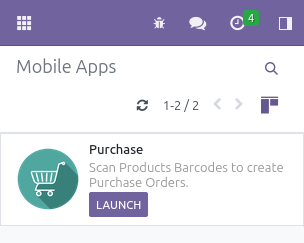
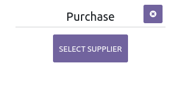
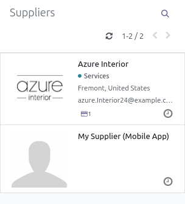
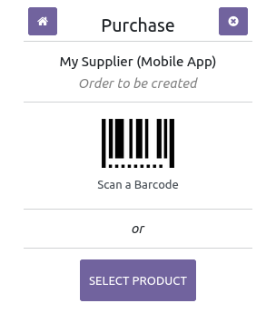
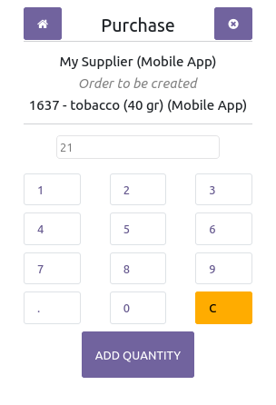

- Click on "Mobile Apps" Menu.
- Launch the "Purchase" application.

- The next page proposes to the user to select a supplier.

- Click on Select a supplier and click then on the supplier you want.

- The next page allows you to choose a product.

If you use a mobile with a barcode scanner, you can scan a barcode, to
select the product.

Otherwise, you can manually select a product, if it doesn't have a
barcode set. Only product related to the selected
  supplier will be displayed.

- The next page allows you to set a quantity. Tip a quantity, then click
  on the button "Add quantity"

